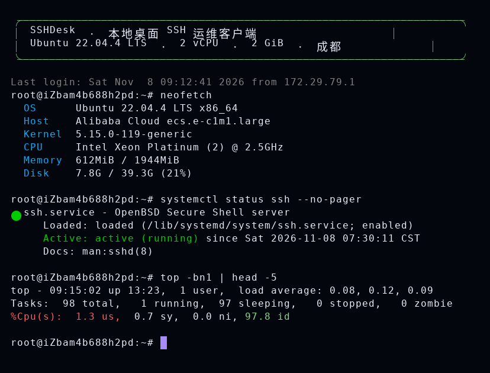

# SSHDesk · 本地桌面 SSH 运维客户端


📽 **不想读字？先看动图演示：[docs/DEMO.md](docs/DEMO.md)**（命令行、登录、终端、状态面板，四段 GIF）

🎨 **界面为什么长这样：[docs/DESIGN-AUDIT.md](docs/DESIGN-AUDIT.md)**（星空配色推导 + 23 条规范逐项自查）

一个跑在自己电脑上的 SSH 客户端：管多台 Linux 服务器、真终端交互、传文件、看监控、
连不上时告诉你卡在哪一步。不用装 XShell / SecureCRT，也不需要给服务器装任何 Web 面板。



> 上图是把终端屏幕缓冲区（`core/terminal_screen.py`）直接渲染出来的真实输出，
> 包含 ANSI 颜色、粗体、反显、中文对齐与光标定位——不是画的效果图。

---

## 它解决什么问题

日常连一台云服务器，通常要在「终端软件 / 文件传输软件 / 监控命令 / 排错文档」之间来回切。
SSHDesk 把这些收进一个窗口，并且专门处理一个高频困境：

**服务器没有公网 IP 时，本地客户端永远连不上，但报错只有一个 `timed out`。**
（阿里云学生机、特惠机默认公网带宽为 0，只有私网地址，控制台的 Workbench 却能连上。）

所以内置了「连接诊断」：不登录、只做网络层探测，直接告诉你是缺公网 IP、安全组没放行、
sshd 没起、还是 ufw 拦住了，并给出对应的操作路径。

---

## 功能

| 能力 | 说明 |
|---|---|
| 多服务器管理 | 名称/分组/标签/备注，配置存 `~/.sshdesk/servers.json`（0600） |
| 三种认证 | 私钥（ed25519/ecdsa/rsa）、密码（AES 加密落盘，可选不保存）、ssh-agent |
| 跳板机 | `user@host:port`，走 SSH `direct-tcpip` 通道 |
| 交互终端 | 真实 PTY + VT100/xterm 解析，支持 vim / top / htop 的彩色与光标控制 |
| 文件传输 | 本地↔远端双栏浏览，目录递归上传下载，进度条 |
| 监控面板 | CPU/内存/磁盘/负载/TOP 进程，5 秒自动刷新（每轮独立连接，不抢占终端） |
| 连接诊断 | 私网地址识别、TCP 探测 + SSH banner 校验、阿里云公网 IP 指引 |
| 服务器体检 | 登录后检查 sshd/ufw/密码登录/fail2ban/磁盘/swap |
| 批量执行 | 按分组并发在 N 台机器上跑同一条命令，失败隔离 |
| 数据库式审计 | 每次连接/执行/传文件写 JSONL，口令自动脱敏 |
| **滚动历史** | 鼠标滚轮 / PgUp 回看最近 2000 行，敲任意键回到最新 |
| **SSH config 导入** | 一条命令把 `~/.ssh/config` 里的主机全部导进来 |
| **手机可用（Web 版）** | 浏览器打开就能连，令牌鉴权，移动端布局与软键盘适配 |
| 无界面可用 | 完整 CLI，SSH/诊断/监控/传文件都不依赖 GUI |

---

## 快速开始

```bash
# 1. 装依赖（tkinter 是 Python 自带的；Linux 若缺：sudo apt install python3-tk）
pip install -r requirements.txt

# 2. 启动图形界面
python -m sshdesk gui

# 3. 不连真实服务器，先看界面长什么样
python -m sshdesk gui --demo

# 4. 想让手机也能连？起一个本地 Web 终端
python -m sshdesk web --port 8080
```

Windows 双击 `start.bat`，macOS / Linux 执行 `bash start.sh` 即可（会自动建虚拟环境）。

### 第一次添加服务器

图形界面点「+ 新增」，或者用命令行：

```bash
python -m sshdesk add -n 阿里云成都 -H 203.0.113.10 -u root -a key -k ~/.ssh/id_ed25519 -g 生产
python -m sshdesk test 阿里云成都          # 先诊断连通性
python -m sshdesk test 阿里云成都 --login  # 连上后再做服务器体检
python -m sshdesk gui                      # 打开界面操作
```

### 命令行速查

```bash
python -m sshdesk list                                  # 列出服务器
python -m sshdesk exec 阿里云成都 "df -h / && uptime"    # 单机执行
python -m sshdesk exec --group 生产 "systemctl status nginx"  # 整组并发
python -m sshdesk monitor 阿里云成都 --watch 3           # 监控（每 3 秒刷新）
python -m sshdesk sftp ls 阿里云成都 /var/log            # 列远端目录
python -m sshdesk sftp put 阿里云成都 --local ./app.tar.gz --remote /opt/app.tar.gz
python -m sshdesk sftp get 阿里云成都 --remote /var/log/nginx/error.log --local ./error.log
python -m sshdesk audit --limit 50                       # 看操作审计
python -m sshdesk import-ssh --dry-run                   # 预览 ~/.ssh/config 里的主机
python -m sshdesk import-ssh                             # 真的导入（同名跳过，--force 覆盖）
python -m sshdesk web --port 8080                        # 启动浏览器版终端
```

---

## 手机上用：Web 版

桌面端要开电脑，出门在外只有手机时，用同一个 core 层起的浏览器终端：

```bash
python -m sshdesk web --port 8080
```

启动后会打印访问地址和令牌（令牌也保存在 `~/.sshdesk/web_token`，0600）。
手机浏览器打开 `http://电脑IP:8080`，粘贴令牌即可进入，界面是移动端布局，
终端会自动适配屏幕宽度、跟随软键盘高度。

**默认只监听 127.0.0.1**，这是有意的。想让手机访问，按安全性从高到低：

1. **SSH 隧道（最推荐）**：在电脑上 `ssh -L 8080:127.0.0.1:8080 手机可访问的机器`；
2. **Nginx 反代 + HTTPS**：设 `SSHDESK_WEB_SECURE_COOKIE=1`，只代理 `/` 与 `/ws/`；
3. 直接 `--host 0.0.0.0` 暴露端口 —— 只建议在家庭内网，且务必配合安全组/防火墙白名单。

安全上做了这些事：

- 令牌用 `hmac.compare_digest` 常数时间比对，登录失败 60 秒内超过 5 次直接 429；
- Cookie 是 `HttpOnly` + `SameSite=Strict`，前端拿不到也带不出去；
- WebSocket 同样要过令牌，未授权用自定义关闭码 `4401` 通知前端跳回登录页；
- **首次连接的未知主机默认拒绝**（浏览器里没法弹窗让你核对指纹）。先在电脑上
  `python -m sshdesk test 机器名 --login --trust-host` 确认一次，Web 端会复用同一份
  `known_hosts`；确实要自动信任就设 `SSHDESK_WEB_AUTO_TRUST=1`，每次都会写审计。

端口被占用时（例如 8080 已被别的服务占了）换一个即可：`--port 8090`。

## 你这台服务器现在连不上的原因

如果实例详情里出现下面这些特征，本机**无论怎么试都连不上**，这不是客户端的问题：

- 公网 IP 显示 `-`
- 私网 IP 类似 `172.29.x.x`
- 带宽计费方式为「按使用流量」，当前带宽 `0 Mbps`

### 三种可选做法

**A. 开通公网 IP（想长期用自己的客户端，走这条）**

1. 阿里云控制台 → 实例详情 → 「分配公网 IP」或「绑定弹性公网 IP」
2. 计费方式选「按使用流量」，峰值带宽 1~3 Mbps 足够（约 0.8 元/GB）
3. 安全组入方向放行 TCP 22，授权对象填你自己的公网出口 IP（不要 0.0.0.0/0）
4. `python -m sshdesk test 机器名` 应变成「SSH 端口 ✅」

**B. 不花钱先用 Workbench**

控制台的「Workbench 远程连接」走内网通道，免费、立即可用，适合装环境、改配置。
但它只能在浏览器里用，没法跑本项目的图形界面。

**C. 走跳板机 / VPN**

如果已有一台有公网的机器，在「跳板机」字段填 `user@公网跳板机:22`，SSHDesk 会用
`direct-tcpip` 通道穿透到内网目标机；也可以先连公司 VPN 再用私网地址直连。

---

## 项目结构

```
sshdesk/
├── sshdesk/
│   ├── core/                  # 与界面无关，CLI 和 GUI 共用，全部可单测
│   │   ├── config.py          # 服务器配置模型 + 原子写入的 JSON 仓库
│   │   ├── credentials.py     # PBKDF2 + Fernet 加密的口令库；私钥加载
│   │   ├── client.py          # 连接/主机指纹 TOFU/保活/跳板机/PTY/exec
│   │   ├── terminal_screen.py # VT100 屏幕缓冲（ANSI 解析 → 字符网格）
│   │   ├── sftp.py            # 双栏浏览 + 递归上传下载
│   │   ├── monitor.py         # 一次往返采集 + 纯函数解析
│   │   ├── diagnostics.py     # 私网识别 / 端口+banner 探测 / 结论生成
│   │   ├── executor.py        # 多机并发执行 + 结果汇总
│   │   ├── sshconfig.py       # 解析 ~/.ssh/config（Host/Port/IdentityFile/ProxyJump）
│   │   └── audit.py           # JSONL 审计日志 + 脱敏
│   ├── ui/                    # tkinter 界面
│   │   ├── app.py             # 主窗口、会话、批量与诊断入口
│   │   ├── terminal_view.py   # 终端渲染与按键映射
│   │   ├── monitor_view.py    # 指标卡片 + 进程表
│   │   ├── sftp_view.py       # 双栏文件浏览器
│   │   ├── server_form.py     # 新增/编辑表单
│   │   └── theme.py           # 深色主题、跨平台字体探测
│   ├── web/                   # 浏览器版（FastAPI + WebSocket + xterm.js）
│   │   ├── server.py          # 令牌鉴权、服务器列表、监控接口、终端 WS
│   │   └── static/            # index.html / app.js / style.css / vendor(xterm.js)
│   └── cli.py                 # argparse 命令行
├── tests/                     # 88 个单元测试
├── docs/
│   ├── ARCHITECTURE.md        # 设计取舍与实现细节
│   └── render_preview.py      # 无显示环境下的终端渲染验收脚本
├── requirements.txt
├── pyproject.toml
└── start.sh / start.bat
```

---

## 测试

```bash
pip install pytest
python -m pytest          # 88 passed
```

覆盖的是最容易出错、也最值得讲的部分：VT100 解析（颜色/光标/滚屏/中文双宽/增量 UTF-8）、
监控输出解析、诊断结论、配置原子写入与损坏恢复、口令加密不落明文、批量执行失败隔离、
ssh config 解析、Web 层鉴权（401/429/4401/4404、Cookie 属性、字段脱敏）。

```bash
# 终端渲染的视觉验收（不需要显示器）
python docs/render_preview.py    # 生成 docs/terminal-preview.png
```

---

## 安全边界（请如实理解）

- **主机指纹**：首次连接弹出指纹确认，确认后写入 `~/.sshdesk/known_hosts`；指纹变化会拒绝连接。
- **口令存储**：主密钥由本机 `machine-id` + 用户名经 PBKDF2(200k) 派生，AES(Fernet) 加密后落盘。
  目标是「磁盘上不出现明文密码」，**不抗能读到你本机文件的攻击者**。更强的保护请用系统 keyring。
- **私钥**：只读取，不复制、不写回；建议 `chmod 600`。
- **审计日志**：`~/.sshdesk/audit.log`，记录连接与命令，`password=xxx` / `Bearer xxx` / 私钥块自动脱敏。
- **权限**：`~/.sshdesk` 目录 0700，配置文件 0600。

## 已知限制

- 终端实现了常用 VT100/xterm 子集，不追求 100% 兼容：DCS、鼠标上报、六线图（sixel）等未支持。
- 终端按「中文=2 列」的等宽假设渲染；若系统等宽字体对 CJK 宽度不支持，可能出现轻微错位。
- 桌面端保留最近 2000 行历史（滚轮 / PgUp 回看），Web 端由 xterm.js 管理滚动，容量更大。
- Web 版是单用户单令牌模型，没有多账号与权限体系；多人共用请自行加反代鉴权。
- Web 版只支持已保存的凭据（密钥/agent/已存密码），不支持在网页里临时输入密码，避免口令进入浏览器历史。
- GUI 在 Windows / macOS / 常见桌面 Linux 上运行；无头容器里的 Tk 需要真实 X 服务。
