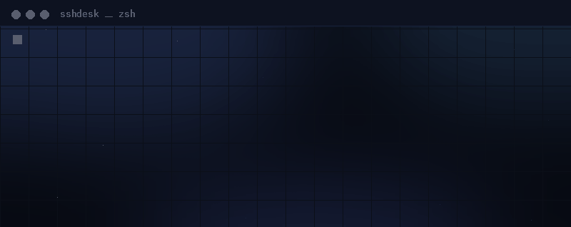
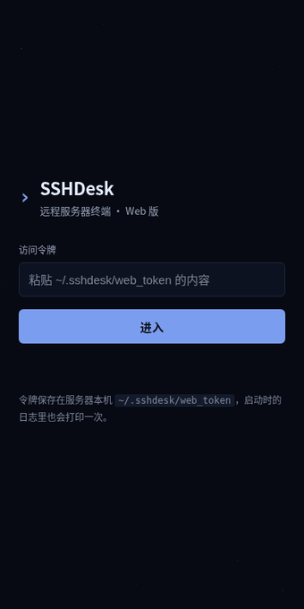
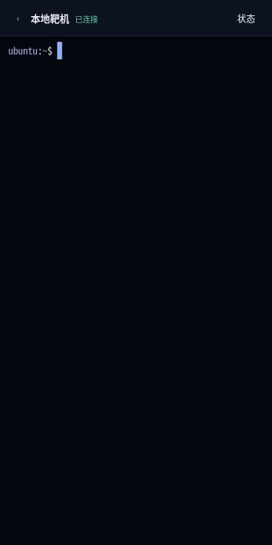
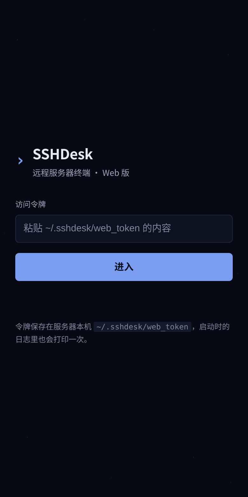
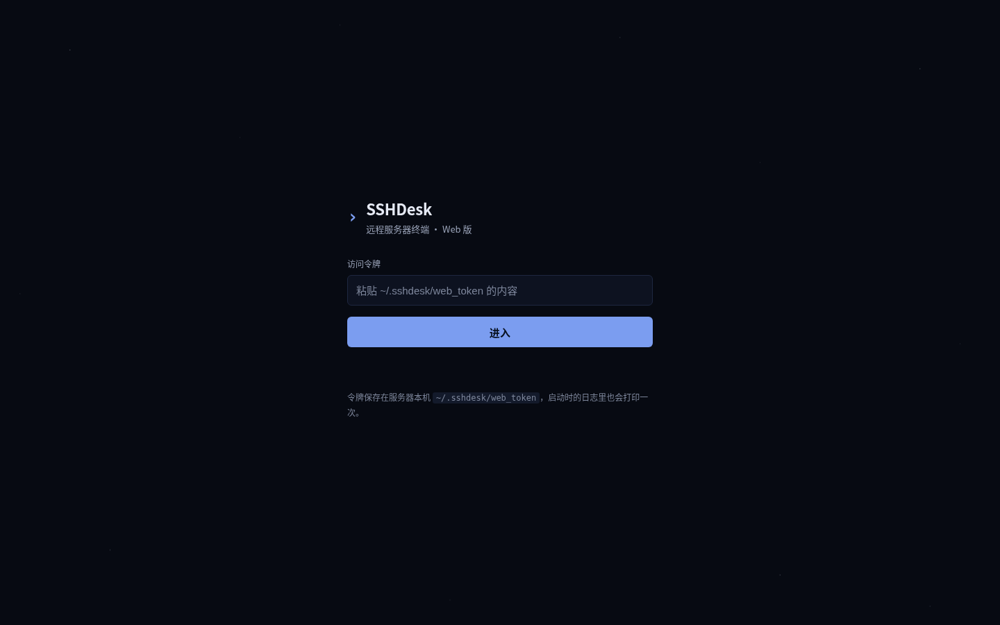
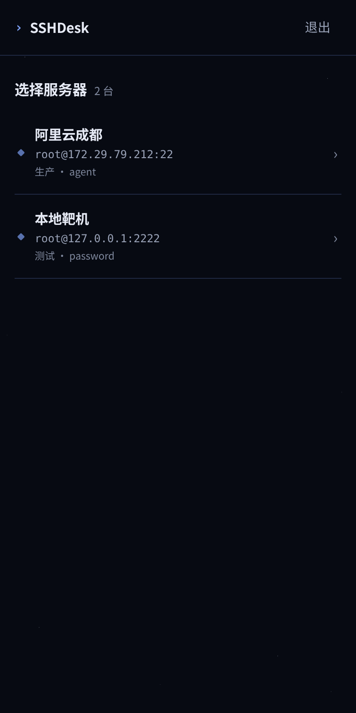
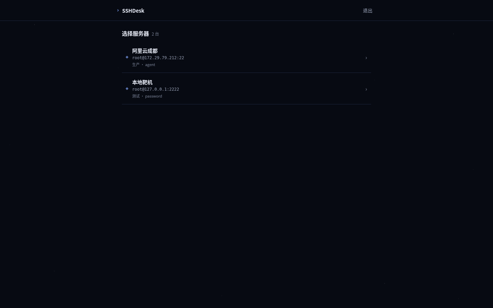
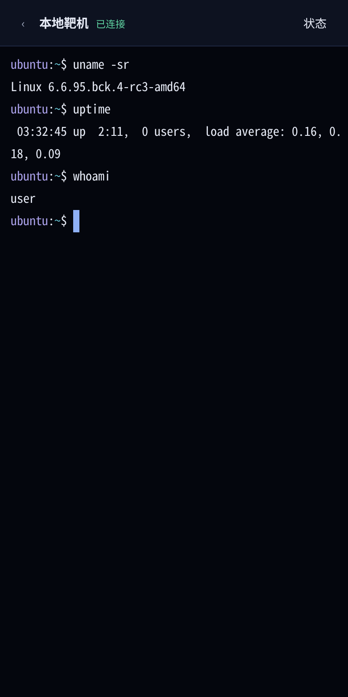
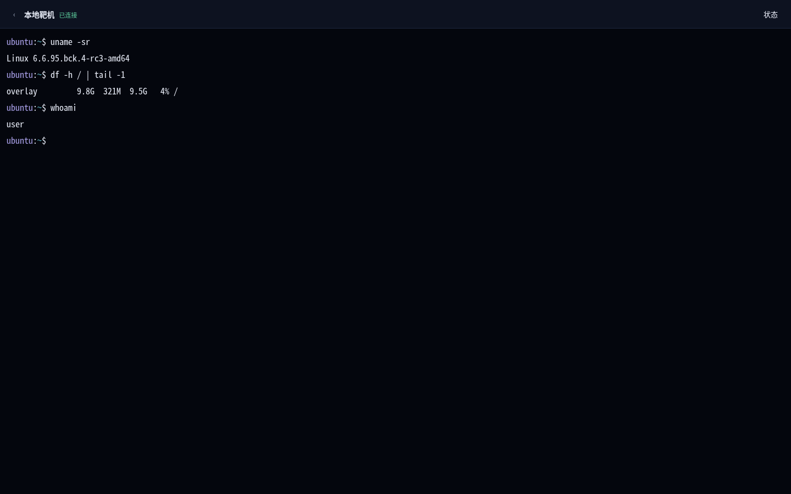

# SSHDesk 演示

四段动图 + 静态图，覆盖从装依赖到在手机上看服务器负载的全过程。
动图都是**真实操作录屏**（Playwright 逐帧截图合成的 GIF，不是手绘示意图），
跑的是项目自带的 Web 界面，连的是项目自带的测试用 SSH 服务端。

> 文中出现的 `203.0.113.10` 是文档专用示例地址，不是任何真实服务器。
> 界面截图里的 `172.29.x.x`、`127.0.0.1` 都是内网/本机地址。

---

## 一、命令行：装依赖 → 加服务器 → 看一眼



**画面里发生了什么：**

1. `pip install -r requirements.txt` —— 装 paramiko 和 cryptography。
2. `python -m sshdesk add ...` —— 一条命令加一台服务器，`-a agent` 表示走本机 SSH Agent 认证，
   `-g 生产` 是分组，列表里会显示这个分组。
3. `python -m sshdesk list` —— 打印表格。**中文列宽按 2 列算**，
   所以「阿里云成都」和英文列能对齐；这个对齐是代码里用 `unicodedata.east_asian_width` 算的，
   不是手写空格。

**为什么不直接连：** 先 `add` 再 `list` 再 `test`，是因为连不上时最常见的原因不是密码错，
而是地址本身不可达（私网 IP、安全组没开、sshd 没起）。`test` 子命令会逐项告诉你卡在哪一层，
输出长这样：

```
诊断目标：203.0.113.10:22
总体结论：❌ ERROR
  ⚠️ 地址类型：172.29.x.x 是私网地址，只能在同 VPC / VPN / 跳板机内访问
  ❌ SSH 端口：TCP 连接超时（数据包没能到达主机或没有回包）
  ✅ 认证方式：SSH Agent
建议：
  1. ... 要么给实例分配公网 IP / 绑定 EIP，要么通过跳板机或 VPN 接入。
```

---

## 二、浏览器：输入令牌 → 服务器列表



**画面里发生了什么：**

1. 打开 `http://你的服务器:8080`，先看到登录页——只有一个输入框。
2. 逐字输入访问令牌（启动日志里会打一次，也存在 `~/.sshdesk/web_token`）。
3. 点「进入」，按钮变成「验证中…」并禁用，成功后跳到服务器列表。
4. 列表每行是：**名称 / 用户名@主机:端口 / 分组 · 认证方式**，右侧 `›` 进入终端。

**为什么要有令牌：** 这个 Web 服务是暴露在公网上的，谁都能访问到端口。
所以它不接受 SSH 密码登录，只认一个本地生成的随机令牌；连续输错 5 次锁 60 秒；
登录成功后下发的 Cookie 是 `httponly + samesite=strict`，脚本偷不走。

---

## 三、点开服务器 → 真终端 → 敲命令


**画面里发生了什么：**

1. 点「本地靶机」这一行，顶部状态从「连接中…」变成**「已连接」**。
   （这个细节是特意做的：WebSocket 连上不等于 SSH 连上，中间还有密钥交换和认证。）
2. 出现一个真正的终端——不是 `textarea` 伪装的输入框，是 xterm.js 渲染的字符网格。
3. 逐字敲 `uname -sr`，回显内核版本；`uptime`，回显运行时长与负载；`whoami && date +%F`，回显用户与日期。

**背后的链路：**

```
浏览器 xterm.js
   │  二进制帧（原始字节，不做 base64 转码）
   ▼
FastAPI WebSocket  ──►  paramiko  ──►  远端 sshd  ──►  bash + pty
   ▲                                          │
   └──────────── 输出回灌 ────────────────────┘
```

- 输入方向：`onData` → JSON `{type:"input"}` → 直接写进 SSH 通道。
- 输出方向：一个常驻线程读 SSH 通道，用 `loop.call_soon_threadsafe` 把数据塞回 asyncio 队列，
  再由协程发成 WebSocket 二进制帧——**没有轮询，也没有阻塞事件循环**。
- 窗口大小：手机旋转或键盘弹出时，前端重新 `fit()`，把新的 `cols/rows` 发给后端，
  后端调 `chan.resize_pty()`。所以远端 `vim`、`top` 这类全屏程序排版是对的。

---

## 四、点右上角「状态」→ 看服务器资源



**画面里发生了什么：**

1. 终端页右上角点「状态」，底部升起面板。
2. 面板里是实时采集的：CPU、内存、磁盘（带进度条）、负载、用量明细、运行时长、系统版本、sshd 状态、TOP 进程。
3. 点「关闭」收回。

**它是怎么采的：** 不复用你正在用的那个交互终端（那会把你正在敲的东西打断），
而是**另开一条 SSH 连接**跑一段只读采集脚本，0.5 秒左右返回。
采集失败返回 502 而不是 500，前端显示「读取失败」而不是整页崩掉。

---

## 五、PC 与手机两档

同一套代码，两个视口。手机是主力场景（服务器出问题时人不在电脑前），PC 是顺带能用。

| | 手机 390×780 | PC 1440×900 |
|---|---|---|
| 登录 |  |  |
| 列表 |  |  |
| 终端 |  |  |

窄屏是单列铺满；宽屏把列表限宽 760px 居中——**否则一行服务器信息会被拉成横跨 1440 的空白条**，
眼睛要从最左边扫到最右边才看得完。终端页不设限宽，终端本来就该越宽越好，
但宽屏会把字号从 14 提到 16，不然字符细到看不清。

配色与设计取舍的完整推导见 [`DESIGN-AUDIT.md`](DESIGN-AUDIT.md)。

---

## 六、三分钟跑起来

```bash
git clone <你的仓库地址> && cd sshdesk
pip install -r requirements.txt

# 1) 加一台服务器（示例地址为文档专用，换成你自己的）
python -m sshdesk add -n 阿里云成都 -H 203.0.113.10 -u root -a key -k ~/.ssh/id_ed25519 -g 生产

# 2) 先体检，再连：逐项告诉你 DNS/端口/握手/认证卡在哪一步
python -m sshdesk test 阿里云成都 --login

# 3A) 桌面版
python -m sshdesk gui

# 3B) 手机 / 浏览器版
python -m sshdesk web --port 8080
# 启动日志里会打印访问令牌；手机浏览器打开 http://<电脑IP>:8080
```

> 手机上连不上，十有八九是 `--host` 还是默认的 `127.0.0.1`。
> 要让手机访问，必须 `python -m sshdesk web --host 0.0.0.0 --port 8080`。

---

## 七、测试

```bash
pytest -q
```

88 个测试，覆盖配置读写、VT100 屏幕缓冲、监控采集、诊断链路、凭据加密、
SSH config 解析、Web 接口鉴权与关闭码。其中 `core/` 与 `web/` 的测试完全不依赖图形界面，
可以在没有显示器的服务器上跑。

---

## 八、当前限制（如实写）

- 桌面版（tkinter）需要本机有显示环境；无头服务器上跑 `gui` 会直接报错，用 Web 版。
- Web 版默认走 HTTP，令牌会明文过网。放到公网请套 Nginx + HTTPS，
  并设置 `SSHDESK_WEB_SECURE_COOKIE=1`。
- 监控面板每次打开会新建一条 SSH 连接，不是长连接轮询。
- 不支持 SFTP 拖拽上传（桌面版有独立 SFTP 面板，Web 版暂未做）。
