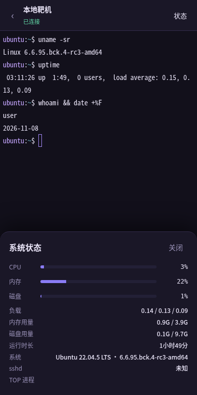

# SSHDesk 演示：三段动图看懂它在干什么

> 下面三段都是**真实浏览器操作录屏**（Playwright 逐帧截图合成的 GIF，不是手绘示意图），
> 跑的是项目自带的 Web 版界面，连着项目自带的测试用 SSH 服务端。

---

## 一、输入令牌 → 进入服务器列表


**画面里发生了什么：**

1. 打开 `http://你的服务器:8080`，先看到登录页——只有一个输入框。
2. 逐字输入访问令牌（就是启动时日志里打的那串，或 `~/.sshdesk/web_token` 的内容）。
3. 点「进入」，跳到服务器列表：每张卡片显示**名称、用户名@主机:端口、分组、认证方式**。
4. 卡片右上角的 `›` 点进去就是终端。

**为什么要有这一步：** 这个 Web 服务是暴露在公网上的，谁都能访问到端口。
所以它不接受 SSH 密码登录，只认一个本地生成的随机令牌；连续输错 5 次锁 60 秒；
登录成功后下发的 Cookie 是 `httponly + samesite=strict`，脚本偷不走。

---

## 二、点开服务器 → 真终端 → 敲命令


**画面里发生了什么：**

1. 点「本地靶机」这张卡片，顶部状态从 **「握手中…」** 变成 **「已连接」**。
   （这个细节是特意做的：WebSocket 连上不等于 SSH 连上，中间还有密钥交换和认证。）
2. 出现一个真正的终端——不是 `textarea` 伪装的输入框，是 xterm.js 渲染的字符网格。
3. 逐字敲 `uname -sr`，回车，回显内核版本。
4. 敲 `uptime`，回显运行时长和负载。
5. 敲 `whoami && date +%F`，回显当前用户和日期。

**背后的链路：**

```
浏览器 xterm.js
   │  二进制帧（原始字节，不做 base64 转码）
   ▼
FastAPI WebSocket  ──►  paramiko  ──►  远端 sshd  ──►  bash + pty
   ▲                                          │
   └──────────── 输出回灌 ────────────────────┘
```

- 输入方向：`onData` → JSON `{type:"input"}` → 直接写进 SSH 通道。
- 输出方向：一个常驻线程读 SSH 通道，用 `loop.call_soon_threadsafe` 把数据塞回 asyncio 队列，
  再由协程发成 WebSocket 二进制帧——**没有轮询，也没有阻塞事件循环**。
- 窗口大小：手机旋转或键盘弹出时，前端重新 `fit()`，把新的 `cols/rows` 发给后端，
  后端调 `chan.resize_pty()`。所以远端 `vim`、`top` 这类全屏程序排版是对的。

---

## 三、点右上角「状态」→ 看服务器资源


**画面里发生了什么：**

1. 终端页右上角点「状态」，底部升起一个面板。
2. 面板里是实时采集的：CPU 占用、内存占用、磁盘占用（带进度条）、负载、
   内存/磁盘用量明细、运行时长、系统版本、sshd 是否在跑、TOP 进程。
3. 点「关闭」收回。

**它是怎么采的：** 不复用你正在用的那个交互终端（那会把你正在敲的东西打断），
而是**另开一条 SSH 连接**跑一段只读采集脚本，0.5 秒左右返回。
采集失败会返回 502 而不是 500，前端显示「读取失败」而不是整页崩掉。

---

## 四、静态图（关键页面）

| 登录 | 服务器列表 |
|---|---|
|  |  |

| 终端 | 状态面板 |
|---|---|
|  |  |

桌面版（tkinter）的终端渲染效果见 [`terminal-preview.png`](terminal-preview.png)，
它同样是把 `core/terminal_screen.py` 的缓冲区直接画出来的真实输出。

---

## 五、三分钟跑起来

```bash
git clone <你的仓库地址> && cd sshdesk
pip install -r requirements.txt

# 1) 加一台服务器（示例：阿里云 Ubuntu）
python -m sshdesk add -n 阿里云成都 -H 47.108.222.188 -u root -a key -k ~/.ssh/id_ed25519 -g 生产

# 2) 先体检，再连：会逐项告诉你 DNS/端口/握手/认证卡在哪一步
python -m sshdesk test 阿里云成都 --login

# 3A) 桌面版
python -m sshdesk gui

# 3B) 手机 / 浏览器版
python -m sshdesk web --port 8080
# 启动日志里会打印访问令牌；手机浏览器打开 http://<电脑IP>:8080
```

---

## 六、测试

```bash
pytest -q
```

88 个测试，覆盖配置读写、VT100 屏幕缓冲、监控采集、诊断链路、凭据加密、
SSH config 解析、Web 接口鉴权与关闭码。其中 `core/` 与 `web/` 的测试完全不依赖图形界面，
可以在没有显示器的服务器上跑。

---

## 七、当前限制（如实写）

- 桌面版（tkinter）需要本机有显示环境；无头服务器上跑 `gui` 会直接报错，用 Web 版。
- Web 版默认走 HTTP，令牌会明文过网。放到公网请套 Nginx + HTTPS，
  并设置 `SSHDESK_WEB_SECURE_COOKIE=1`。
- 监控面板每次打开会新建一条 SSH 连接，不是长连接轮询。
- 不支持 SFTP 拖拽上传（桌面版有独立 SFTP 面板，Web 版暂未做）。
